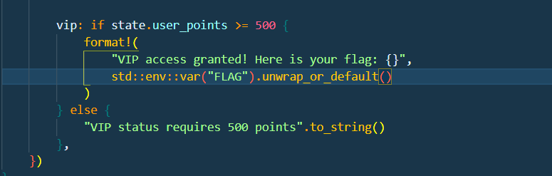
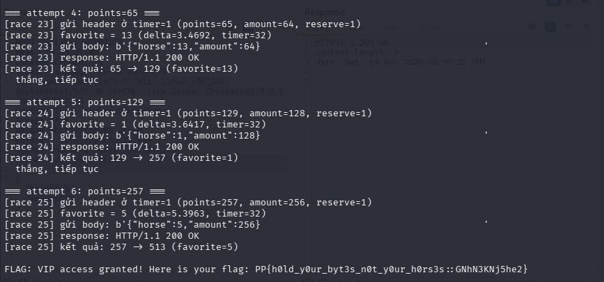

# CTF Writeup - 11/14/2026

**Challenge:** Hold Your Horses\
**Category:** Web\
**Flag:** `PP{h0ld_y0ur_byt3s_n0t_y0ur_h0rs3s::GNhN3KNj5he2}`

------------------------------------------------------------------------

## Tổng quan

Challenge yêu cầu người chơi đặt cược đua ngựa và tích lũy **500
points** để đạt điều kiện nhận flag.

Ứng dụng được viết bằng **Rust**, sử dụng Axum để xử lý HTTP request.
Người chơi bắt đầu với 10 points và phải chọn đúng con ngựa chiến thắng
qua từng chặng đua để tăng số điểm.

------------------------------------------------------------------------

## Reconnaissance

### Luật chơi và cơ chế đua

Giao diện challenge cho biết người chơi cần đặt cược vào ngựa chiến
thắng để tích lũy đủ 500 points.



Các thông tin ban đầu:

-   Người chơi bắt đầu với **10 points**.
-   Mỗi chặng đua có chiều dài **100 m**.
-   Có **16 con ngựa** để lựa chọn.
-   Mỗi chặng có một con được chọn ngẫu nhiên làm **favorite**.
-   Favorite có tốc độ gấp đôi các con ngựa còn lại và là con ngựa chiến
    thắng theo logic của challenge.
-   Mỗi chặng có khoảng **30 giây chuẩn bị** để đặt cược, sau đó cuộc
    đua bắt đầu và kéo dài thêm hơn 30 giây.


### Vấn đề

Favorite được chọn ngẫu nhiên ở mỗi chặng. Vì vậy, không thể đoán trước
favorite của chặng tiếp theo chỉ dựa vào kết quả của chặng trước.

Nếu thử lần lượt từng con ngựa bằng cách đặt cược, người chơi phải chờ
hết thời gian chuẩn bị và thời gian đua cho mỗi lần thử. Cách này rất
tốn thời gian, đồng thời mỗi chặng lại có favorite mới.


------------------------------------------------------------------------

## Phân tích source code

### Endpoint `/api/state`

Endpoint này trả về trạng thái hiện tại của cuộc đua, bao gồm:

-   `race_number`: số thứ tự chặng đua.
-   `timer`: thời gian hiện tại của chặng.
-   `horses`: mảng thể hiện quãng đường mỗi con ngựa đã di chuyển.
-   `user_points`: số points hiện có.
-   `user_bet`: thông tin cược hiện tại.


``` json
{
  "race_number": 5,
  "timer": 33,
  "horses": [
    2.7544334, 4.4709177, 4.5252523, 4.066428,
    3.3891282, 1.8688442, 4.3359222, 2.511949,
    2.6054192, 3.491749, 5.5049877, 0.73289144,
    2.2983277, 0.64901304, 2.9547753, 8.570086
  ],
  "user_points": 9,
  "user_bet": null,
  "vip": "VIP status requires 500 points"
}
```

### Endpoint đặt cược

Phân tích source code cho thấy request đặt cược được xử lý qua
middleware `betting_open` trước khi đến handler `bet()`.


Middleware kiểm tra timer:


Nếu `timer >= 30`, middleware từ chối request. Ngược lại, request được
chuyển tiếp bằng `next.run(request).await`.


Handler `bet()` nhận JSON từ request và xử lý việc đặt cược. Phần đáng
chú ý:

``` rust
Json(bet_request): Json<BetRequest>
```

Axum sử dụng `Json<BetRequest>` để đọc body và deserialize JSON thành
`BetRequest`.

Sau khi kiểm tra số points và index của ngựa, handler cập nhật trạng
thái:

``` rust
state.user_bet = Some((bet_request.horse, bet_request.amount));
state.user_points -= bet_request.amount;
```


**Điểm yếu:** handler kiểm tra số points và ngựa được chọn nhưng không
kiểm tra lại `timer >= 30`.

Như vậy, việc kiểm tra thời gian chỉ được thực hiện ở middleware. Nếu
middleware chuyển tiếp request trước khi body được đọc hoàn tất, có thể
tồn tại khoảng thời gian giữa lúc kiểm tra timer và lúc handler thực sự
xử lý dữ liệu cược.

------------------------------------------------------------------------

## Bước 1 --- Suy đoán favorite qua `/api/state`

Vì favorite có tốc độ gấp đôi các ngựa còn lại, có thể suy đoán favorite
bằng cách lấy hai response `/api/state` ở hai tick liên tiếp rồi tính
mức tăng quãng đường của từng con:

``` text
distance[i] = horses_t2[i] - horses_t1[i]
```

Nếu tốc độ cơ bản nằm trong khoảng 0--3 và favorite có tốc độ gấp đôi,
mức tăng của favorite có thể nổi bật hơn các con còn lại.

Con có mức tăng quãng đường lớn bất thường so với các con khác là ứng
viên favorite.

Cần lưu ý rằng một snapshot đơn lẻ không đủ để kết luận chắc chắn. Nên
so sánh các response liên tiếp và đối chiếu với cách source code cập
nhật tốc độ.

------------------------------------------------------------------------

## Bước 2 --- Khai thác TOCTOU trong luồng xử lý request

### Nguyên nhân

Middleware `betting_open` kiểm tra:

``` rust
if state.read().await.timer >= 30 {
    return Err((StatusCode::BAD_REQUEST, "Race already started".to_string()));
}
```

Nếu timer nhỏ hơn 30, request được chuyển tiếp:

``` rust
Ok(next.run(request).await)
```

Điểm quan trọng là HTTP request có thể được xử lý theo luồng dữ liệu:
headers được nhận và phân tích trước, còn body có thể tiếp tục đến sau.

Middleware có thể chuyển tiếp request khi body chưa được đọc hết. Sau
đó, `Json<BetRequest>` trong handler sẽ đọc body. Nếu body chưa đến đủ,
quá trình đọc body có thể phải chờ dữ liệu tiếp theo.

Khi body đến, request tiếp tục được xử lý tại handler đang chờ đọc body;
nó **không quay lại chạy middleware `betting_open` từ đầu**.

### Kịch bản khai thác

Ý tưởng khai thác là tạo một HTTP request đặt cược nhưng cố tình chưa
gửi body. Nhờ đó, request có thể vượt qua middleware `betting_open`
trong thời gian chuẩn bị, sau đó giữ handler ở trạng thái chờ dữ liệu
cược.

Quá trình khai thác diễn ra theo trình tự sau:

#### Bước 1: Gửi HTTP headers trước, chưa gửi body

Client mở kết nối TCP đến server và gửi phần request line cùng headers:

``` http
POST /api/bet HTTP/1.1
Host: 10.83.21.42
Content-Type: application/json
Content-Length: 64
Connection: keep-alive
```

Lúc này, client chưa gửi JSON body nhưng đã khai báo
`Content-Length: 64`, cho server biết request còn có phần body dài 64
byte cần đọc.

#### Bước 2: Request vượt qua middleware và handler chờ body

Server nhận headers và bắt đầu xử lý request:

-   Middleware `betting_open` kiểm tra `timer`.
-   Vì request được gửi trong thời gian chuẩn bị (`timer < 30`),
    middleware cho phép request đi tiếp bằng `next.run(request).await`.
-   Handler `bet()` bắt đầu xử lý request. Tuy nhiên, dữ liệu JSON chưa
    được gửi nên extractor `Json<BetRequest>` chưa thể hoàn thành việc
    đọc và deserialize body.

Lúc này, request đã vượt qua bước kiểm tra của middleware nhưng vẫn chưa
hoàn tất việc xử lý tại handler. Client giữ kết nối và chưa gửi body.

#### Bước 3: Cuộc đua bắt đầu trong khi handler vẫn chờ dữ liệu

Khi timer đạt 30 giây, cuộc đua bắt đầu.

Thông thường, nếu gửi một request đặt cược mới ở thời điểm này,
middleware sẽ từ chối vì `timer >= 30`. Tuy nhiên, request đã gửi ở bước
1 không phải thực hiện lại bước kiểm tra middleware.

Trong khi handler vẫn chờ body, client sử dụng một kết nối khác để liên
tục gọi `GET /api/state`, lấy vị trí hiện tại của 16 con ngựa.

Bằng cách so sánh hai response ở hai tick liên tiếp, client tính mức
tăng quãng đường của từng con để xác định favorite.

#### Bước 4: Gửi body của request đang chờ

Sau khi xác định được favorite, client gửi JSON body qua chính kết nối
TCP đã mở ở bước 1:

``` json
{"horse": 2, "amount": 10}
```

Server tiếp tục đọc body mà handler đang chờ. Axum deserialize JSON
thành `BetRequest`, sau đó handler `bet()` xử lý thông tin cược.

Điểm quan trọng là request này đã vượt qua middleware từ trước. Việc gửi
body sau khi cuộc đua bắt đầu không khiến request quay lại thực hiện
middleware `betting_open`.

Do đó, nếu handler không kiểm tra lại timer, dữ liệu cược vẫn có thể
được xử lý dù thời gian đặt cược đã kết thúc.


Vì vậy, client có thể gửi headers trước rồi trì hoãn body mà vẫn duy trì
một HTTP request duy nhất.

**Điều kiện quan trọng để khai thác thành công:** middleware phải chuyển
tiếp request trước khi body được đọc hoàn tất, đồng thời handler không
kiểm tra lại thời gian đặt cược. 

------------------------------------------------------------------------

## Bước 3 --- Tích lũy 500 points

Sau khi xác định được favorite của chặng hiện tại:

1.  Gửi body của request đang chờ với `horse` là index của favorite.
2.  Đặt cược số points phù hợp với số points hiện có.
3.  Chờ chặng đua kết thúc và kiểm tra số points mới qua `/api/state`.
4.  Lặp lại quy trình với chặng tiếp theo vì favorite được random lại ở
    mỗi race.

Tiếp tục cho đến khi đạt điều kiện **500 points**.



------------------------------------------------------------------------

## Flag

``` text
PP{h0ld_y0ur_byt3s_n0t_y0ur_h0rs3s::GNhN3KNj5he2}
```
