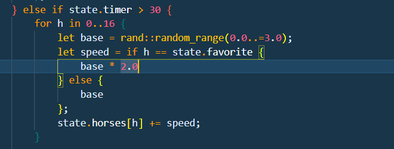
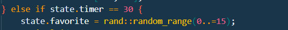
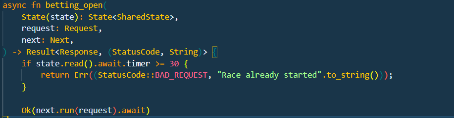
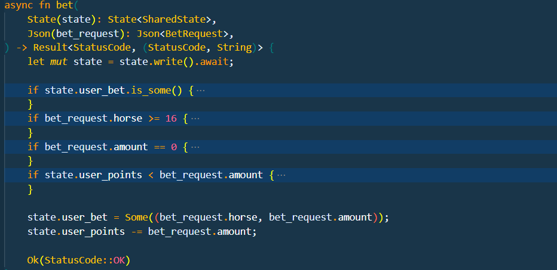

# CTF Writeup - 11/14/2026

**Challenge:** Hold Your Horses\
**Category:** Web\
**Flag:** `PP{h0ld_y0ur_byt3s_n0t_y0ur_h0rs3s::GNhN3KNj5he2}`

------------------------------------------------------------------------

## Tổng quan

Challenge yêu cầu người chơi đặt cược đua ngựa và tích lũy **500
points** để đạt điều kiện nhận flag.

Ứng dụng được viết bằng **Rust**, sử dụng Axum để xử lý HTTP request.
Người chơi bắt đầu với 10 points và phải chọn đúng con ngựa chiến thắng
qua từng chặng đua để tăng số điểm.


------------------------------------------------------------------------

## Reconnaissance

### Luật chơi và cơ chế đua

Giao diện challenge cho biết người chơi cần đặt cược vào ngựa chiến
thắng để tích lũy đủ 500 points.


Các thông tin ban đầu:

-   Người chơi bắt đầu với **10 points**.
-   Mỗi chặng đua có chiều dài **100 m**.
-   Có **16 con ngựa** để lựa chọn.
-   Mỗi chặng có một con được chọn ngẫu nhiên làm **favorite**.
-   Favorite có tốc độ gấp đôi các con ngựa còn lại và là con ngựa chiến
    thắng theo logic của challenge.
-   Mỗi chặng có khoảng **30 giây chuẩn bị** để đặt cược, sau đó cuộc
    đua bắt đầu và kéo dài thêm hơn 30 giây.



### Vấn đề

Favorite được chọn ngẫu nhiên ở mỗi chặng. Vì vậy, không thể đoán trước
favorite của chặng tiếp theo chỉ dựa vào kết quả của chặng trước.

Nếu thử lần lượt từng con ngựa bằng cách đặt cược, người chơi phải chờ
hết thời gian chuẩn bị và thời gian đua cho mỗi lần thử. Cách này rất
tốn thời gian, đồng thời mỗi chặng lại có favorite mới.



------------------------------------------------------------------------

## Phân tích source code

### Endpoint `/api/state`

Endpoint này trả về trạng thái hiện tại của cuộc đua, bao gồm:

-   `race_number`: số thứ tự chặng đua.
-   `timer`: thời gian hiện tại của chặng.
-   `horses`: mảng thể hiện quãng đường mỗi con ngựa đã di chuyển.
-   `user_points`: số points hiện có.
-   `user_bet`: thông tin cược hiện tại.

Ví dụ response:

``` json
{
  "race_number": 5,
  "timer": 33,
  "horses": [
    2.7544334, 4.4709177, 4.5252523, 4.066428,
    3.3891282, 1.8688442, 4.3359222, 2.511949,
    2.6054192, 3.491749, 5.5049877, 0.73289144,
    2.2983277, 0.64901304, 2.9547753, 8.570086
  ],
  "user_points": 9,
  "user_bet": null,
  "vip": "VIP status requires 500 points"
}
```



### Endpoint đặt cược

Phân tích source code cho thấy request đặt cược được xử lý qua
middleware `betting_open` trước khi đến handler `bet()`.

Middleware kiểm tra timer:

``` rust
async fn betting_open(
    State(state): State<SharedState>,
    request: Request,
    next: Next,
) -> Result<Response, (StatusCode, String)> {
    if state.read().await.timer >= 30 {
        return Err((
            StatusCode::BAD_REQUEST,
            "Race already started".to_string()
        ));
    }

    Ok(next.run(request).await)
}
```

Nếu `timer >= 30`, middleware từ chối request. Ngược lại, request được
chuyển tiếp bằng `next.run(request).await`.


Handler `bet()` nhận JSON từ request và xử lý việc đặt cược. Phần đáng
chú ý:

``` rust
Json(bet_request): Json<BetRequest>
```

Axum sử dụng `Json<BetRequest>` để đọc body và deserialize JSON thành
struct `BetRequest`.

Sau khi kiểm tra số points và index của ngựa, handler cập nhật trạng
thái:

``` rust
state.user_bet = Some((bet_request.horse, bet_request.amount));
state.user_points -= bet_request.amount;
```



**Điểm yếu:** handler kiểm tra số points và ngựa được chọn nhưng không
kiểm tra lại `timer >= 30` trong vùng đang giữ write lock.

Như vậy, việc kiểm tra thời gian chỉ được thực hiện ở middleware. Có một
khoảng thời gian giữa lúc middleware kiểm tra timer và lúc handler thực
sự xử lý dữ liệu đặt cược.

------------------------------------------------------------------------

## Bước 1 --- Thử suy đoán favorite qua `/api/state`

Vì favorite có tốc độ gấp đôi các ngựa còn lại, có thể suy đoán favorite
bằng cách lấy hai response `/api/state` ở hai tick liên tiếp rồi tính
mức tăng quãng đường của từng con:

``` text
delta[i] = horses_t2[i] - horses_t1[i]
```

Nếu tốc độ cơ bản nằm trong khoảng 0--3, favorite có tốc độ gấp đôi, tức
mức tăng có thể nằm trong khoảng 0--6 trong một tick (tùy cách game cập
nhật tốc độ).

Con có mức tăng nổi bật so với các con còn lại là ứng viên favorite.

**Hạn chế:**

-   Chỉ có thể quan sát tốc độ sau khi cuộc đua bắt đầu.
-   Một mẫu đo đơn lẻ có thể chưa đủ để kết luận nếu tốc độ cơ bản được
    random theo từng tick.
-   Cần lấy nhiều mẫu liên tiếp để so sánh ổn định hơn.

Do đó, cách này giúp nhận diện favorite nhưng không giải quyết được vấn
đề đặt cược trước khi cuộc đua bắt đầu.

------------------------------------------------------------------------

## Bước 2 --- Khai thác TOCTOU trong luồng xử lý request

### Nguyên nhân

Middleware `betting_open` kiểm tra:

``` rust
if state.read().await.timer >= 30 {
    return Err((StatusCode::BAD_REQUEST, "Race already started".to_string()));
}
```

Nếu timer nhỏ hơn 30, request được chuyển tiếp:

``` rust
Ok(next.run(request).await)
```

Điểm quan trọng là HTTP request có thể được xử lý theo luồng dữ liệu:
headers được nhận và parse trước, còn body có thể tiếp tục đến sau.

Middleware có thể chuyển tiếp request khi body chưa được đọc hết. Sau
đó, `Json<BetRequest>` trong handler sẽ đọc body. Nếu body chưa đến đủ,
extractor sẽ chờ dữ liệu tiếp theo.

Khi body đến, request tiếp tục ở handler đang chờ đọc body; nó **không
quay lại chạy middleware `betting_open` từ đầu**.

### Kịch bản khai thác

Có thể chia việc gửi request thành hai phần:

1.  Gửi request line và headers, chưa gửi body.
2.  Đợi đến khi cuộc đua bắt đầu, xác định favorite qua `/api/state`,
    rồi gửi phần body chứa lựa chọn ngựa và số points cược.

Ví dụ phần headers được gửi trước:

``` http
POST /api/bet HTTP/1.1
Host: 10.83.21.42
Content-Length: 22
Accept-Language: en-US,en;q=0.9
User-Agent: Mozilla/5.0 (X11; Linux x86_64) AppleWebKit/537.36 (KHTML, like Gecko) Chrome/143.0.0.0 Safari/537.36
Content-Type: application/json
Accept: */*
Origin: http://10.83.21.42
Referer: http://10.83.21.42/
Accept-Encoding: gzip, deflate, br
Connection: keep-alive
```

Khi headers đến server:

-   Middleware kiểm tra `timer`.
-   Nếu timer vẫn nhỏ hơn 30, request được chuyển tiếp.
-   Handler bắt đầu xử lý nhưng `Json<BetRequest>` chưa thể deserialize
    nếu body chưa đến đủ.

Sau khi cuộc đua bắt đầu, gọi `/api/state` để quan sát các con ngựa. So
sánh các response liên tiếp để tìm favorite.

Khi đã xác định được favorite, gửi body của **chính request đang chờ**:

``` json
{"horse": <favorite_horse>, "amount": 10}
```

Lưu ý: `horse` trong backend là index từ `0` đến `15`. Nếu giao diện
đánh số từ `1` đến `16`, cần chuyển số thứ tự hiển thị sang index tương
ứng trước khi gửi.

### Vì sao có thể xảy ra?

Đây là lỗi **TOCTOU (Time-of-check to Time-of-use)**:

-   **Time of check:** middleware kiểm tra `timer < 30`.
-   **Time of use:** handler xử lý dữ liệu đặt cược sau đó.
-   Trạng thái `timer` có thể thay đổi trong khoảng thời gian giữa hai
    bước.

Do handler không kiểm tra lại timer khi cập nhật `user_bet`, request đã
vượt qua middleware trước đó vẫn có thể được xử lý sau khi cuộc đua bắt
đầu.

**Lưu ý kỹ thuật:** TCP truyền dữ liệu dưới dạng byte stream; không đảm
bảo mỗi lần `send()` tương ứng với một TCP packet riêng. Việc chia
request thành headers và body là cách điều khiển thời điểm gửi dữ liệu ở
phía client. Khả năng khai thác thực tế còn phụ thuộc vào cách
Axum/Hyper nhận và xử lý streaming body, cấu hình timeout/limit và thứ
tự middleware-extractor của ứng dụng.


------------------------------------------------------------------------

## Bước 3 --- Tích lũy 500 points

Sau khi xác định được favorite của chặng hiện tại:

1.  Gửi body của request đang chờ với `horse` là index của favorite.
2.  Đặt cược số points phù hợp với số points hiện có.
3.  Chờ chặng đua kết thúc và kiểm tra số points mới qua `/api/state`.
4.  Lặp lại quy trình với chặng tiếp theo vì favorite được random lại ở
    mỗi race.

Tiếp tục cho đến khi đạt điều kiện **500 points**.


------------------------------------------------------------------------

## Flag

``` text
PP{h0ld_y0ur_byt3s_n0t_y0ur_h0rs3s::GNhN3KNj5he2}
```

------------------------------------------------------------------------

## Tổng kết

Challenge khai thác sự khác biệt giữa thời điểm middleware kiểm tra điều
kiện đặt cược và thời điểm handler thực sự sử dụng dữ liệu request.

Nguyên nhân cốt lõi là:

-   Middleware kiểm tra `timer < 30` nhưng không giữ lock xuyên suốt quá
    trình xử lý request.
-   Body của HTTP request có thể được gửi đến sau headers.
-   Handler `bet()` không kiểm tra lại timer khi cập nhật trạng thái
    cược.

**Hướng khắc phục:** thực hiện kiểm tra timer, kiểm tra số points và cập
nhật cược trong cùng một vùng write lock ở handler. Không nên chỉ dựa
vào middleware để đảm bảo điều kiện nghiệp vụ cần được duy trì tại thời
điểm cập nhật trạng thái.
